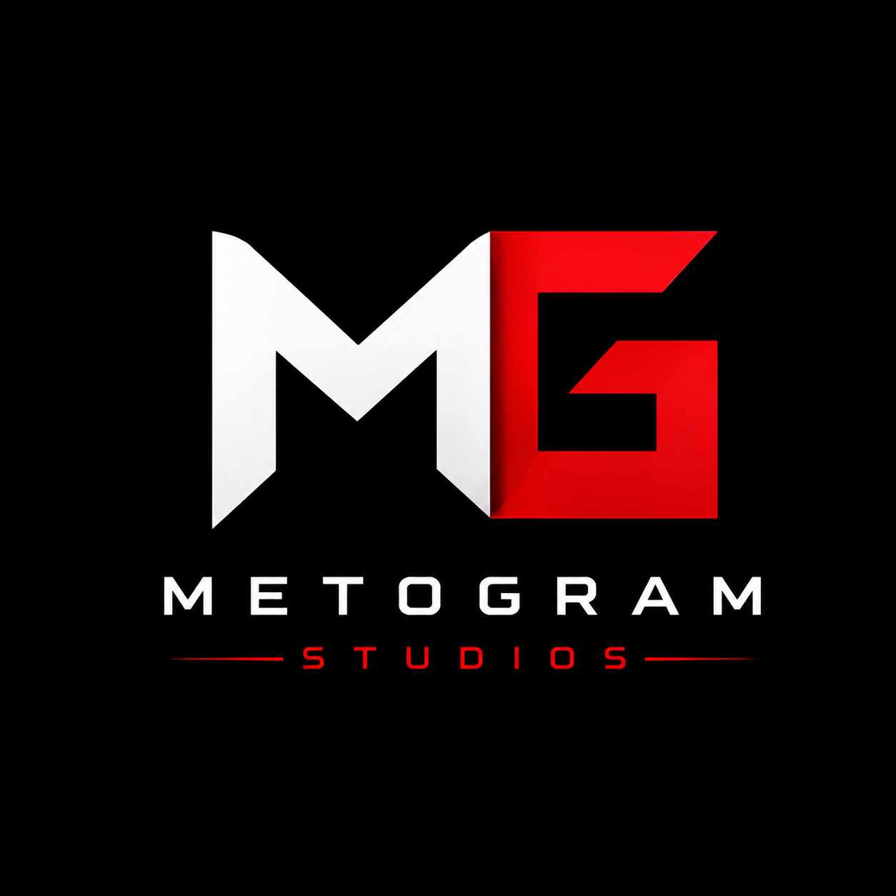
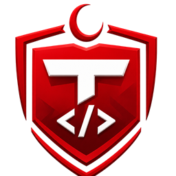

<p align="center">
  
</p>

<h1 align="center">Türkod</h1>

<p align="center">
  <strong>Türkçe kod yaz, tek tuşla çalıştır. 🚀</strong><br/>
  <sub>VS Code için Türkçe programlama dili desteği — Metogram Studios</sub>
</p>

<p align="center">
  
</p>

---

Türkod, Türkçe kelimelerle program yazmayı mümkün kılan bir programlama dilidir:
`değişken`, `eğer`, `döngü`, `fonksiyon`, `yazdır`... İngilizce bilmeyen biri de
kendi dilinde düşünüp kod yazabilsin diye doğdu.

Bu eklenti, Türkod dilini VS Code'a getirir. Bir `.tr` dosyası açtığınız anda
editör sizinle birlikte çalışmaya başlar: yazdığınız kodu renklendirir, hataları
siz yazarken söyler, komutları tamamlar ve `F5`'e bastığınızda programınız
çalışır. Kurulumdan sonra hiçbir şey ayarlamanız gerekmez — dosyayı açın, yazın,
çalıştırın.

## Neden seveceksin? 💙

**Türkçe düşün, Türkçe yaz.** Komut adları Türkçe, hata mesajları Türkçe, arayüz
komutları Türkçe. Yazarken `büyükHarf`, `dosyaOku`, `sırala` gibi 250'den fazla
hazır komut öneri listesinde karşınıza çıkıyor; ezberlemenize gerek yok.

**Hataları sonra değil, şimdi görün.** Eksik `son`, kapatılmamış parantez, yanlış
yazılmış komut adı — hepsi daha siz yazarken Problems panelinde ve satırın altında
kırmızı çizgiyle görünür. Programı çalıştırıp "acaba nerede bozuldu?" diye
aramazsınız.

**Tek tuşla çalışır.** `F5` programı VS Code'un terminalinde çalıştırır. Çıktı
Python'daki gibi terminalde görünür, `oku`/`iste` girdileri normal şekilde
yazılarak alınır. Satır satır hata ayıklamak isterseniz `Shift+F5` yeterli.

**Masaüstü programı yazın.** `içe_aktar TürkUI` dediğinizde buton, giriş alanı,
liste, sekme, kaydırıcı, canvas, hatta gömülü tarayıcı ile gerçek pencereler
kurabilirsiniz. TürkUI pencereleri VS Code'dan bağımsız masaüstü pencereleri
olarak açılır ve isterseniz **tek bir `.exe`** dosyasına paketleyip başka bir
bilgisayara kopyalayabilirsiniz.

**Flutter gibi proje yapısı.** Terminalden `türküi yeni merhaba` yazın; hazır
klasör yapısı, `uygulama.json`, örnek dosyalar ve `assets/` klasörüyle projeniz
oluşsun.

## 30 saniyede başla ⏱️

1. Extensions panelinden **Türkod**'u kurun (veya VSIX dosyasını
   `code --install-extension turkod-vscode.vsix` ile yükleyin).
2. Bir dosya oluşturup `merhaba.tr` adını verin.
3. Şunu yazın:

```tr
değişken ad := "Metehan"
yazdır("Merhaba " + ad + "!")

döngü 3 kez
    yazdır("Türkçe kod yazıyorum")
son
```

4. `F5`'e basın. Program aşağıdaki terminalde çalışır. Hepsi bu. ✅

## Kısayollar

| Kısayol | İşlev |
| --- | --- |
| `F5` / `Ctrl+F5` | Çalıştır |
| `Shift+F5` | Satır satır hata ayıkla |
| `Ctrl+Shift+F5` | İmlece kadar çalıştır |
| `Ctrl+Enter` | Seçimi çalıştır |
| `Ctrl+F2` | Durdur |
| `Ctrl+Space` | Öneri listesini / açıklama panelini aç |

## TürkUI ile arayüz 🪟

```tr
içe_aktar TürkUI

değişken p := TürkUI.pencere("Merhaba")
değişken etiket := p.metin("Adınız nedir?")
değişken giris := p.giriş("Adınızı yazın")
değişken dugme := p.buton("Selamla")
p.göster()

dugme.tıklandığında
    etiket.içerik := "Merhaba " + giris.değer
    etiket.renk := renk.yeşil
son
```

Renkler, stiller ve olay adları da Türkçe: `TürkUI.stil { buton(arkaPlanRengi: mavi) }`,
`düğme.olayDinle("tıklandığında", ...)`. HTML veya İngilizce CSS yazmanız gerekmez.

> TürkUI uygulamaları Electron ile çalışır ve uzantının içinde taşınmaz. Gerekince
> Komut Paleti'nden **Türkod: TürkUI Modülünü İndir** ile tek seferde indirilir.

## Komut satırı araçları

```powershell
türküi yeni merhaba      # yeni proje oluşturur
türküi çalıştır          # projeyi çalıştırır
türkod modül liste       # indirilmiş modülleri gösterir
```

## Daha fazlası 📚

Bu sayfa başlangıç içindir. Tüm dil öğeleri, komut listesi, TürkUI bileşenleri,
`Zaman` modülü, betik blokları, formüller ve CLI ayrıntıları için:

➡️ **[BELGELER.md](BELGELER.md)** — Türkod başvuru kılavuzu

## Geri bildirim

Bir hata mı buldunuz, bir eksik mi var? Bir özellik öneriniz mi var? Hepsini
memnuniyetle dinlerim — Türkod sizin geri bildiriminizle büyüyor. 🙌

---

<p align="center">
  <sub>Türkod, <strong>Metogram Studios</strong> tarafından geliştirilmektedir.</sub><br/>
  <sub>MIT lisansı · Türkçe programlama dili ve VS Code uzantısı</sub>
</p>
